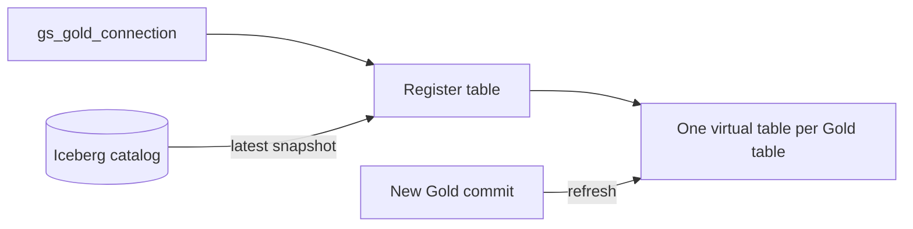
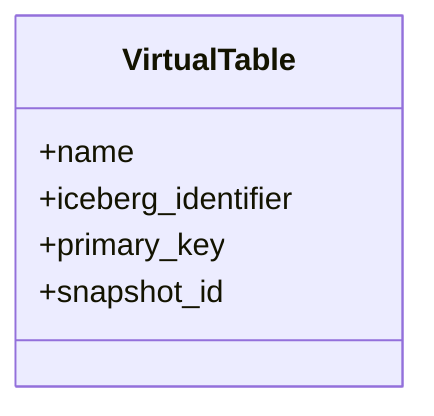

Registers schema definitions over the Parquet files. Data is read in place, so no duplicate copies are made or stored inside Foundry.

## Data flow

## Software components

- **Foundry Virtual Tables** over Apache Iceberg.

## Configuration and metadata

- Seven virtual tables, one per Gold table, same names.
- Refreshed after each daily commit; snapshot ID recorded.

## Low-level design

