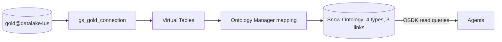
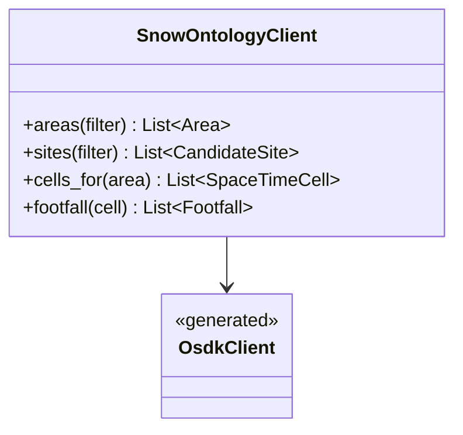

Foundry projects the Gold Parquet files into the `[Snow]` **Ontology**, without copying the data. Agents can then work with real-world objects and links instead of joining flat spatial tables.

## Steps

- **1. GCS Data Connection:** secure read-only path to `gs://gold@datalake4us`.
- **2. Virtual Tables:** schema definitions over the Parquet files, read in place.
- **3. `[Snow]` Ontology Graph:** object types and graph links in Ontology Manager.

New Gold data landing in the lake updates the Ontology. Agents read from it through Arrow 2.

## Data flow

## Software components

- **Palantir Foundry**: Data Connection, Virtual Tables, Ontology Manager.
- **Ontology SDK (OSDK)**, Python, generated for the `[Snow]` Ontology.

## Configuration and metadata

- One Foundry project: `Project Snow`.
- Set up by hand in Ontology Manager for the MVP, then exported as config for reproducibility.
- Agents use one read-only Foundry service user.

## Low-level design

- Agents call `SnowOntologyClient`, a thin wrapper, so tools don't depend on generated OSDK names.
