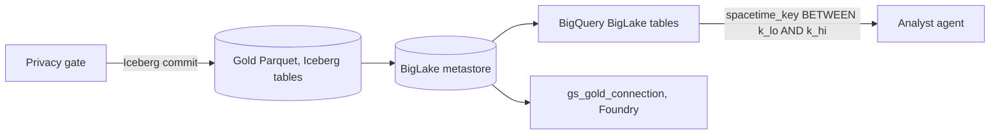
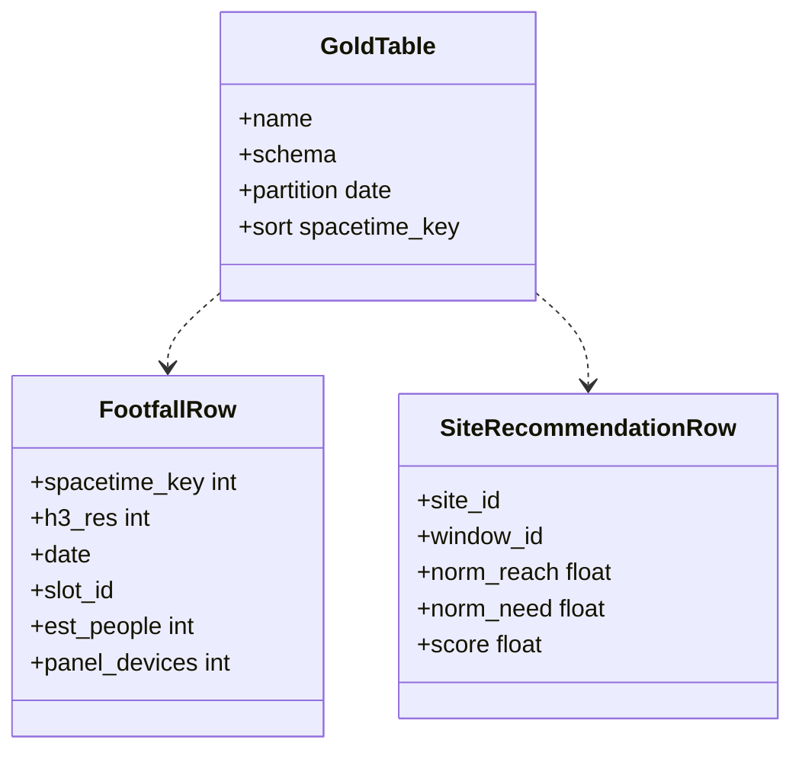

The platform's store for Gold data, `gold@datalake4us`.

## Capabilities

- Stores Snappy-compressed Gold Parquet files
- Uses Apache Iceberg snapshot commits to update table catalog pointers atomically (`partitionOverwriteMode = dynamic`)
- Exposed zero-copy to BigQuery BigLake external tables
- Runs fast 64-bit `spacetime_key` range pruning over Parquet row-group metadata

## Data flow

## Software components

- **Cloud Storage** bucket `gold@datalake4us`, `europe-west2`.
- **Apache Iceberg** tables, Snappy Parquet.
- **BigLake metastore** catalog and **BigQuery** BigLake tables.

## Configuration and metadata

- Tables: `footfall`, `dwell`, `composition`, `origin`, `reach`, `area_need`, `site_recommendation`.
- Partitioned by date; files sorted by `spacetime_key`, so row-group min and max prune range scans.
- Row groups about 128 MB.
- Snapshots kept 30 days for rollback.
- Writer: Orion's pipeline account only. Readers: Foundry connection and the agents' read-only BigQuery account.
- CMEK on the bucket.

## Low-level design

- Two of the seven table shapes shown; the full list is on the Gold datasets arrow.
