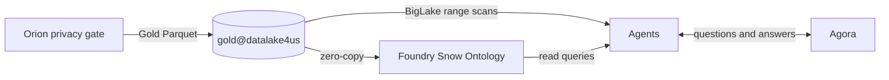
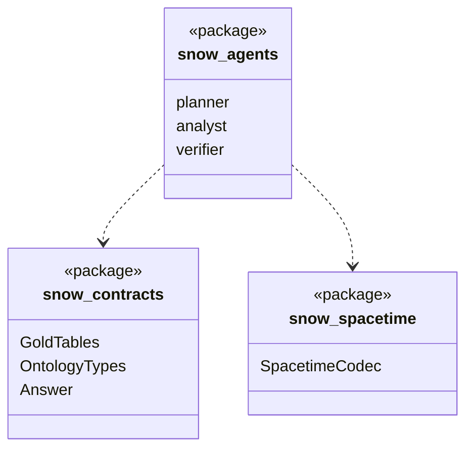

Merlin is FourthSpace's central data engine, query executor and ontology layer.

It receives only Gold datasets from Orion, projects them into the Foundry Ontology, and gives the AI agents structured objects and fast range scans to reason over.

## Data flow

## Software components

- FourthSpace GCP project `merlin-snow`, inside a VPC Service Controls perimeter.
- **Cloud Storage** with **Apache Iceberg** and **BigLake metastore**, **BigQuery** BigLake tables.
- **Palantir Foundry** Ontology.
- **Vertex AI Agent Engine**, **Gemini 4 Argon**, **Model Armor**.

## Low-level design

- The Analyst uses the same `SpacetimeCodec` as Orion's P3 stage, so keys always match.
