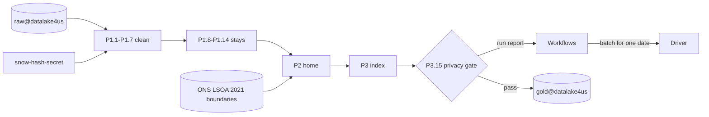
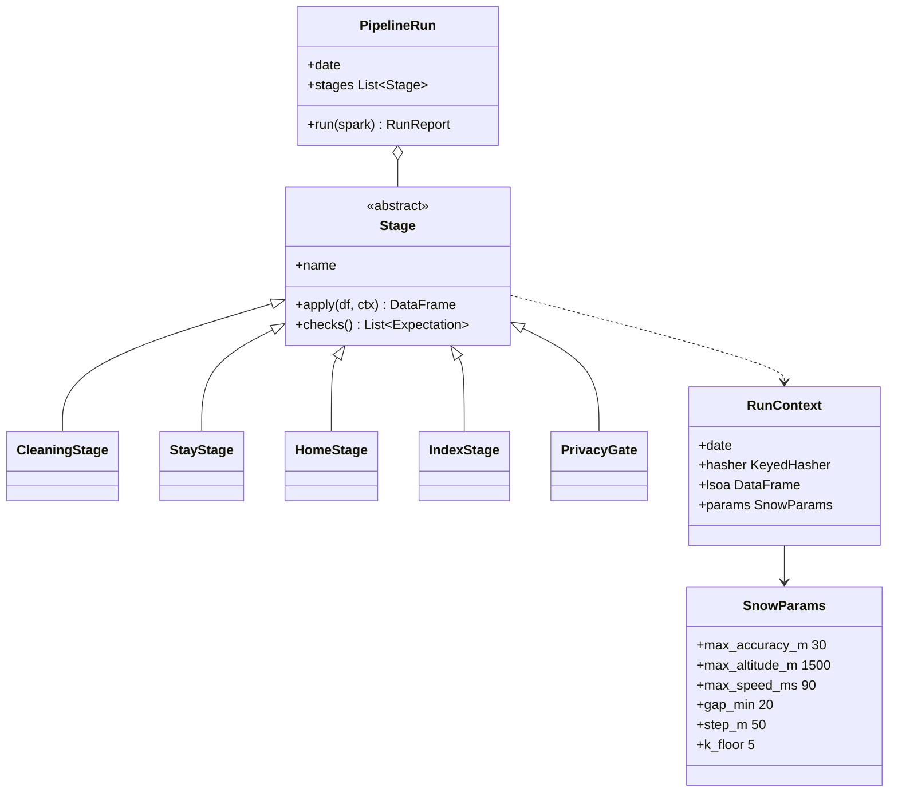

Dynamic, auto-scaling compute runtime (PySpark 3.5, Runtime 2.2). It executes the 5 core pipeline stages in temporary worker memory.

## Steps

- **P1.1–P1.7 De-Id and ping cleaning:** hash identifiers in-line and remove inaccurate pings.
- **P1.8–P1.14 Presence and stay clustering:** group clean pings into classified presences.
- **P2 Home assignment and expansion:** assign night-time home cells and expansion factors.
- **P3 Spacetime-H3 indexing:** encode cells and timestamps into a 64-bit `spacetime_key`.
- **P3.15 Privacy gate:** strip `device_key`, enforce the Floor of 5 and round exported counts.

## Data flow

## Software components

- **Dataproc Serverless for Spark**, runtime 2.2, PySpark 3.5, Python 3.11.
- **h3-py** and **h3-pyspark** for cells, **Apache Sedona** for LSOA point-in-polygon.
- **Apache Iceberg** Spark runtime for the Gold commit.
- **Great Expectations** checks after each stage.

## Configuration and metadata

- Executors: autoscaling 2 to 100; about 0.5 TB a day fits in under an hour.
- Service account: read raw bucket and secret, write `gold@datalake4us` only.
- Private IPs inside the VPC-SC perimeter; no internet egress.
- Spark settings: `partitionOverwriteMode = dynamic`, adaptive query execution on.
- Run report: rows in, rows dropped per filter, devices, cells suppressed, rows published.

## Low-level design

- Every threshold lives in `SnowParams`, so the numbers in the stage boxes have one source.
