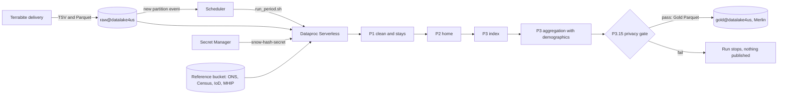
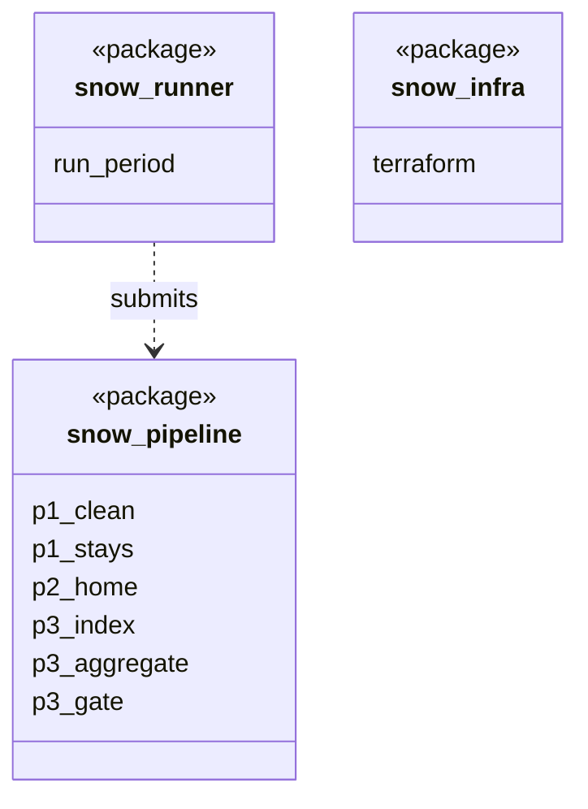

Orion runs strictly as an **ephemeral data processing worker** inside Terrabite's secure GCP project.

Raw personal movement traces and persistent device IDs stay inside this boundary. Only non-linkable Gold Parquet tables that pass the privacy gate are published out to Merlin.

## Data flow

## Software components

- Terrabite's GCP project, inside a **VPC Service Controls** perimeter.
- **Cloud Storage**, **Pub/Sub**, **Workflows**, **Dataproc Serverless**, **Secret Manager**.
- **Cloud KMS** customer-managed keys on the bucket and secret.
- **Terraform** for the project's resources.

## Configuration and metadata

- Workers are ephemeral: no persistent disks, no data kept after a run.
- One path out of the perimeter: the privacy gate's write to `gold@datalake4us`.
- FourthSpace staff have no read access to `raw@datalake4us`.
- Data Access audit logs on for the raw bucket and the secret.

## Low-level design

- Two deployables: the `snow_pipeline` wheel and the `run_period.sh` runner.
