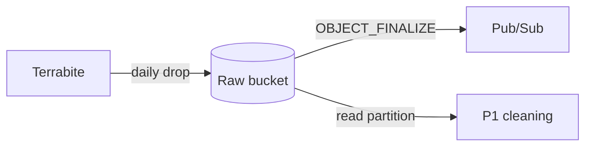
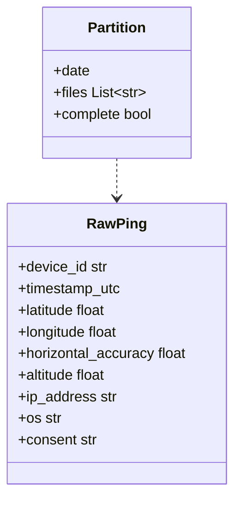

Holds about 0.5 TB of raw TSV and Parquet location files delivered by Terrabite.

## Contents

- 17 raw payload fields per ping
- Raw `device_id`
- UTC timestamp
- WGS84 `latitude` and `longitude`
- Accuracy and altitude
- IP address
- OS type
- Consent status

## Data flow

## Software components

- **Cloud Storage**, single-region `europe-west2` (London).
- **GCS Pub/Sub notifications** on object finalise.

## Configuration and metadata

- Layout: `pings/dt=YYYY-MM-DD/part-*.tsv.gz` (Parquet also accepted).
- Uniform bucket-level access, public access prevention, CMEK.
- Writer: Terrabite's delivery account. Reader: the pipeline service account only.
- Retention: 90 days, then deleted by a lifecycle rule.
- A `_SUCCESS` marker per partition signals a complete delivery.

## Low-level design

- `RawPing` shows 9 of the 17 fields; the rest are network attributes the pipeline drops.
