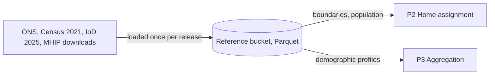
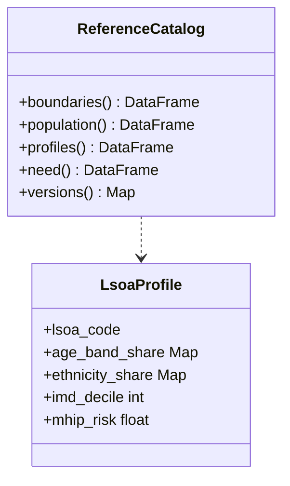

Static public reference data used by the pipeline. It has no device data in it.

## Datasets

- ONS LSOA 2021 boundaries
- ONS LSOA mid-year population, by single year of age
- Census 2021 age bands and ethnicity per LSOA
- Census 2021 health metrics per LSOA
- IoD 2025 IMD ranks and deciles per LSOA
- MHIP cardiovascular and diabetes risk scores per LSOA

## Data flow

## Software components

- **Cloud Storage** bucket in the Orion project, Parquet files.
- A loader script in `snow_infra` that downloads each release, keeps only the 3 boroughs' LSOAs and writes Parquet.

## Configuration and metadata

- Scope: the LSOAs in Barking & Dagenham, Havering and Thurrock, plus a buffer ring of neighbouring LSOAs for home assignment.
- Layout: `reference/<dataset>/<release>/part-*.parquet`, for example `census2021/age_bands/2023-01`.
- Key: `lsoa_code` (LSOA 2021) on every table.
- Read only for the pipeline service account. Data is public and holds no personal data.
- The release version of each table is written into the run report.

> **To confirm:** the MHIP source and how often it is refreshed.

## Low-level design

