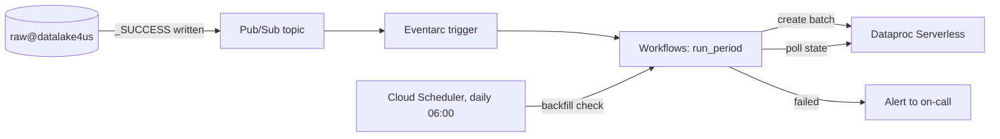
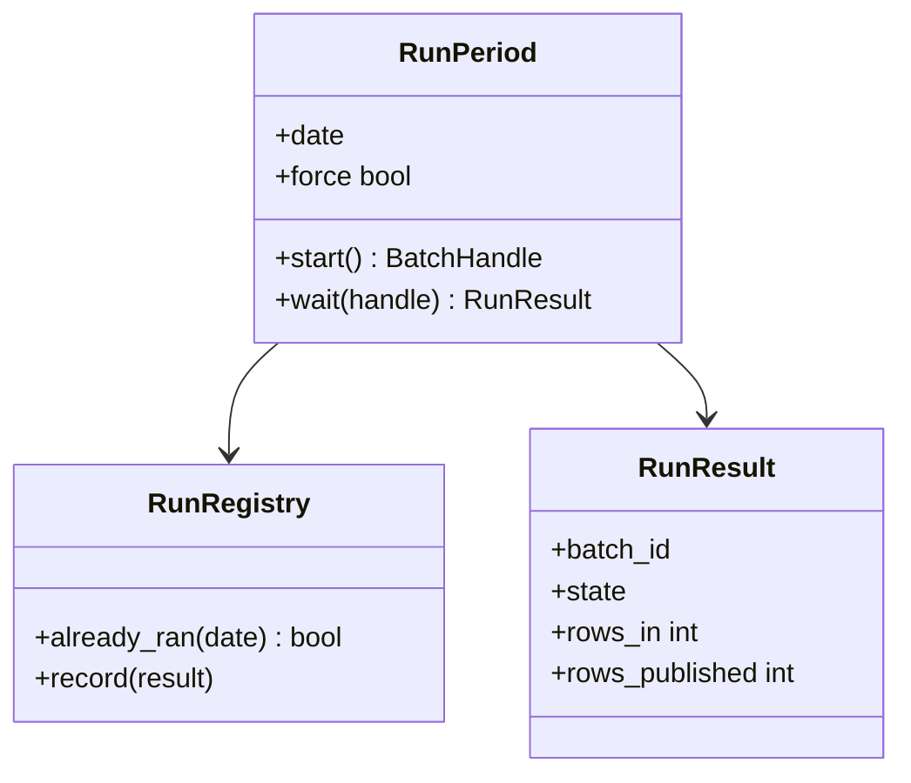

Automatically invokes the headless execution runner (`run_period.sh`) whenever new date partitions arrive.

## Event path

1. GCS Bucket Notifications
2. GCP Pub/Sub events
3. GCP Workflows or Cloud Composer (Airflow)
4. `run_period.sh` starts the Dataproc Serverless run

## Data flow

## Software components

- **Pub/Sub** topic `snow-raw-arrivals`.
- **Eventarc** trigger on that topic.
- **Workflows** running the `run_period` workflow; `run_period.sh` wraps the same call for manual runs.
- **Cloud Scheduler** daily check for missed partitions.

> **To confirm:** Workflows rather than Cloud Composer. Workflows is assumed: one linear job a day doesn't need Airflow.

## Configuration and metadata

- Triggers only on `_SUCCESS` objects, so half-delivered days are never processed.
- One run per date; a second event for the same date is ignored unless forced.
- Retries: 2, with exponential backoff, then an alert.
- Run record: date, batch ID, state, start, end, rows in, rows published.

## Low-level design

