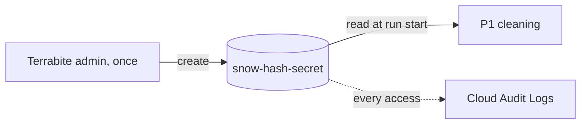
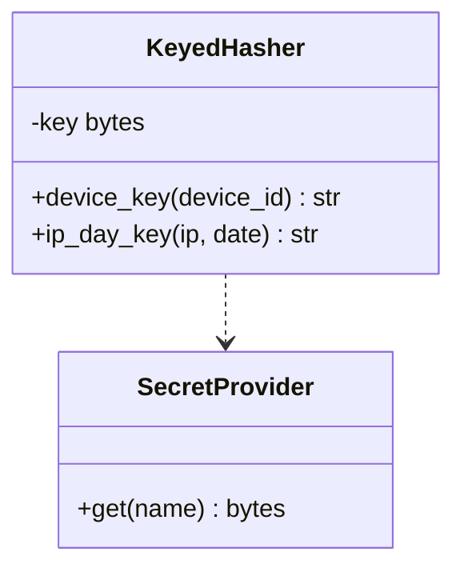

GCP Secret Manager stores the secret salt key, `snow-hash-secret`.

`keyed_hash` (HMAC-SHA256) uses this key to:

- Pseudonymize `device_id` strings into `device_key` tokens
- Generate daily IP hashes (`ip_day_key`)

## Data flow

## Software components

- **GCP Secret Manager**, `europe-west2` replication only.
- **Cloud KMS** customer-managed key.

## Configuration and metadata

- Secret: `snow-hash-secret`, 256-bit random.
- Not rotated during the MVP, so `device_key` stays stable across weeks for P2's lookbacks. Rotating it would break home assignment.
- Access: only the pipeline service account has `secretAccessor`. No FourthSpace access.
- The key is held in executor memory for one run only and never logged.

## Low-level design

- `ip_day_key` mixes in the date, so IP keys can't be linked across days.
