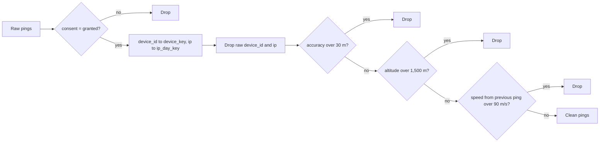
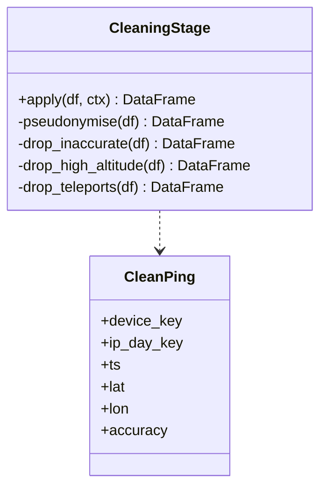

Removes direct identifiers in-line and filters out unreliable pings.

## Steps

- Hash `device_id` to `device_key` with HMAC-SHA256
- Convert raw IP addresses to daily keys
- Drop pings with accuracy above 30 m
- Drop pings with altitude above 1,500 m
- Drop teleportation speeds above 90 m/s

## Data flow

## Software components

- PySpark DataFrame transforms; window functions per `device_key` ordered by time for speed.
- `KeyedHasher` (HMAC-SHA256) as a vectorised pandas UDF.

## Configuration and metadata

- Thresholds from `SnowParams`: 30 m, 1,500 m, 90 m/s.
- Raw `device_id` and IP are dropped in this stage; no later stage can see them.
- Counts dropped per rule go to the run report.

## Low-level design

