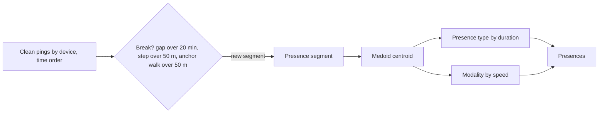
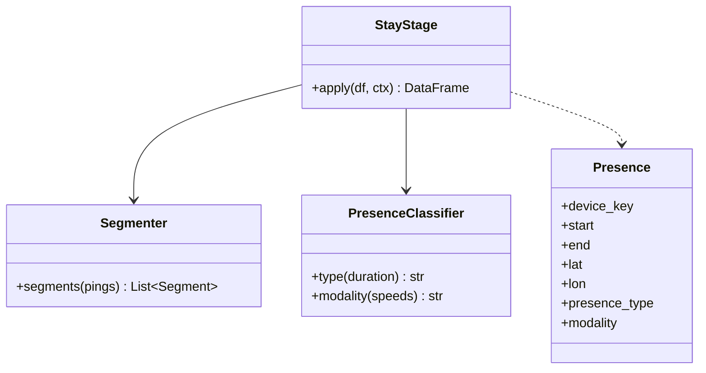

Turns clean pings into presences for each device, in time order.

## Steps

- Group consecutive clean pings per device
- Break on a time gap above 20 min
- Break on a spatial step above 50 m
- Break on an anchor walk above 50 m
- Calculate the geographic medoid centroid
- Classify presence type and movement modality

## Classifications

- **Presence type:** `pass_by`, `short_presence`, `long_stay`, `very_long_stay`
- **Movement modality:** `stationary`, `pedestrian`, `non_pedestrian`

## Data flow

## Software components

- PySpark `applyInPandas` grouped by `device_key`, one device per task.
- A NumPy medoid function (point with the smallest summed distance to the rest).

## Configuration and metadata

- Breaks: 20 min gap, 50 m step, 50 m anchor walk.
- Presence type thresholds by duration: `pass_by`, `short_presence`, `long_stay`, `very_long_stay`.
- Modality by median speed: `stationary`, `pedestrian`, `non_pedestrian`.

> **To confirm:** the exact duration and speed cut-offs for each class.

## Low-level design

