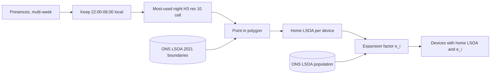
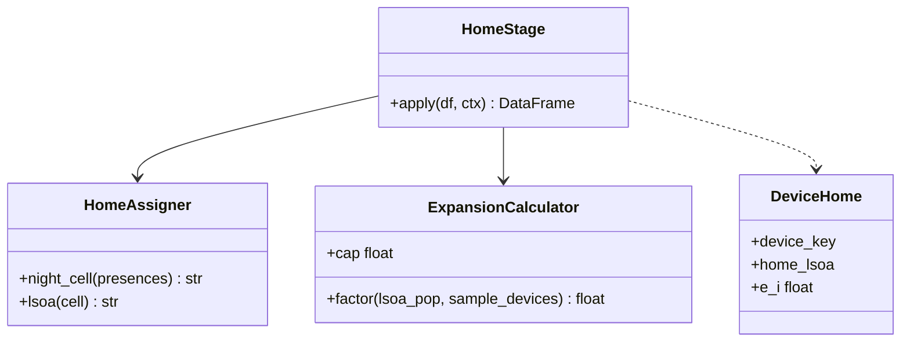

Estimates where devices live and how many people each one represents.

## Steps

- Evaluate night-time presences, 22:00–06:00 local time
- Use multi-week lookbacks
- Assign primary night H3 resolution 10 cells
- Map cells to ONS LSOA 2021 boundaries by point-in-polygon
- Calculate user expansion factors

## Expansion factor

`e_i = min(LSOA Population / Sample Devices, 70.0)`

## Data flow

## Software components

- PySpark with **Apache Sedona** spatial join on LSOA polygons.
- **h3-py** for resolution 10 cells.
- Reference tables: ONS LSOA 2021 boundaries and mid-year population, read from the Reference data bucket.

## Configuration and metadata

- Lookback: 4 weeks of presences (rolling).
- Night window: 22:00 to 06:00 Europe/London, DST-aware.
- Expansion factor capped at 70.0.
- Devices with no stable night cell get no home and are weighted 1.

> **To confirm:** the 4-week lookback.

## Low-level design

