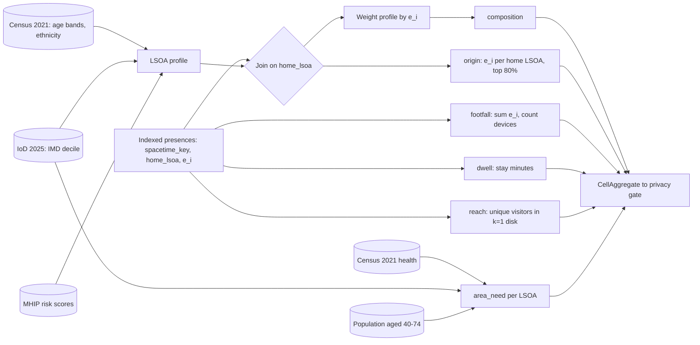
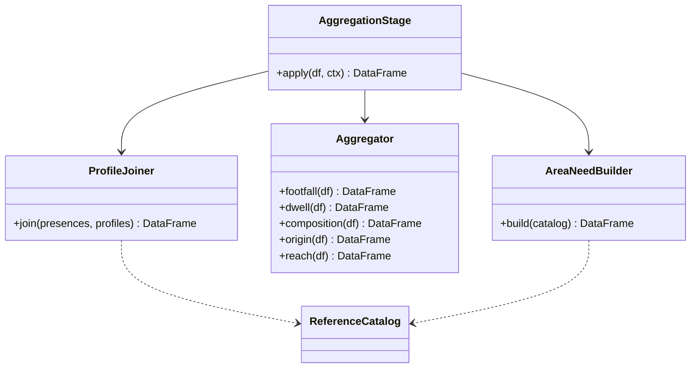

Builds the Gold tables. Joins each visitor's home LSOA to its demographic profile, then sums per space-time cell, weighted by `e_i`.

## Steps

- Join indexed presences to LSOA profiles on `home_lsoa`
- Weight each visitor's home profile by `e_i`
- Sum per `spacetime_key` into `composition` and `origin`
- Sum visitors without joins into `footfall`, `dwell` and `reach`
- Build `area_need` per LSOA from reference data only

## Composition formula

`share(c, g) = Σ e_i × p(g | home_lsoa_i) / Σ e_i`

`p(g | lsoa)` is the share of group `g` (an age band, an ethnicity, or an IMD decile) among that LSOA's residents. It comes from Census 2021, IoD 2025 or MHIP.

## Data flow

## Software components

- PySpark broadcast join: the LSOA profile table is small, about 1,000 rows.
- `ReferenceCatalog` reads the reference bucket.

## Configuration and metadata

- Visitors with no `home_lsoa` go into an `unknown` group in `composition`. They don't take a borough profile.
- Visitors from outside the 3 boroughs and the buffer ring are grouped as `outside`.
- `composition` and `origin` keep `panel_devices` per cell, so the gate can apply the Floor of 5.
- `area_need` holds no device data. It passes the gate's schema checks, but cell suppression doesn't apply to it.
- Composition is an estimate. It assigns each visitor their home LSOA's profile, not their own attributes.

> **To confirm:** whether `p(g | lsoa)` uses residents of all ages or only ages 40–74, the screening target.

## Low-level design

