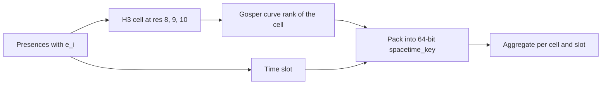
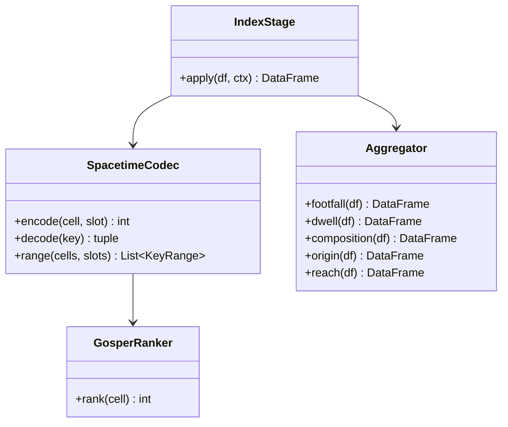

Makes spatial and temporal lookups fast by combining them into one sortable integer.

## Steps

- Take spatial cell centroids at H3 resolution 8, 9 or 10
- Rank cells along the Gosper curve
- Combine the rank with the timestamp
- Encode both into a compact 64-bit integer `spacetime_key`

## Data flow

## Software components

- **h3-py** for cells; a FourthSpace `spacetime` library for Gosper ranking and key packing.
- PySpark aggregations into the Gold table shapes.

## Configuration and metadata

- Key layout: high bits are the Gosper rank, low bits the time slot, so nearby cells and times sort together.
- Time slots: hourly, local time.
- Aggregations build `footfall`, `dwell`, `composition`, `origin` and `reach` before the gate.

> **To confirm:** the exact bit split between space and time.

## Low-level design

- `SpacetimeCodec.range` is reused by the Analyst agent to build `[k_lo, k_hi]` scans.
