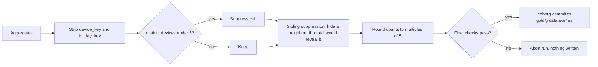
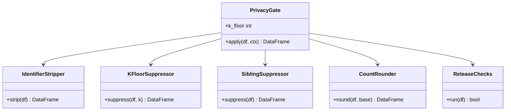

The release boundary. Nothing reaches Merlin without passing this stage.

## Steps

- Permanently strip all pseudonymous `device_key` values
- Enforce the Floor of 5: suppress cells with fewer than 5 distinct panel devices
- Apply secondary sibling suppression
- Round exported counts to multiples of 5

## Data flow

## Software components

- PySpark transforms plus a final **Great Expectations** suite that fails the run on any breach.
- Iceberg writer with `partitionOverwriteMode = dynamic`.

## Configuration and metadata

- k floor: 5 distinct panel devices.
- Rounding: to the nearest 5.
- Final checks: no column named like `device`, `ip` or `key` except `spacetime_key`; every published count at least 5; row count within expected range.
- The gate's report (cells suppressed, rows published) is kept with the run.

## Low-level design

