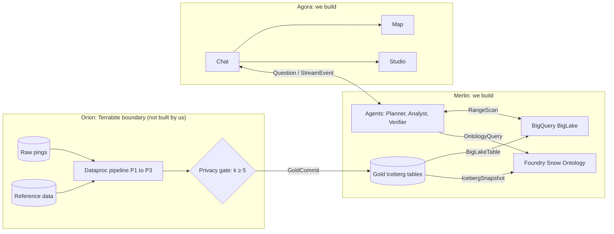

# Project Snow v1: implementation brief

This brief is for a coding agent building Project Snow v1. It covers:

1. The product journey Snow sits in.
2. What v1 builds now, and what it leaves out.
3. Project Snow's architecture, and the two parts we build: **Merlin** and **Agora**.

The source of truth is the **Snow MVP** board on the FourthSpace diagram site, in `content/snow/` of this repo. Each box and arrow there has a data flow, components, configuration and a class diagram. This brief collects what you need from it. Where the two disagree, the board wins. Ask before you change a contract.

Anything marked **To confirm** is an assumption. Build it behind config or a clear interface, so it's cheap to change.

---

## Part 1: The journey

FourthSpace turns raw data about a place into a decision someone can act on and explain. The full product takes a customer through 5 stages. Snow v1 is the first real Project, and only the last stage is built as software (see Part 2).

### 1.1 The idea

- Businesses face critical decisions about places: where to put a bus stop, a police patrol or a farmhouse.
- The bottleneck isn't the decision. It's getting from raw data to signals someone can interpret.
- A single answer isn't enough. Users expect a knowledge base around their decision:
  - candidate locations
  - predictive modelling
  - area insights
  - AI-written reports
  - an interactive map
- Each decision is a **Project**. A Project owns:
  - **Golden Datasets (Gold):** small, GDPR-compliant tables of derived metrics, indexed by Spacetime-H3.
  - **Ontology Graph:** a semantic view of the Gold tables in Palantir Foundry, made of object types and links.
  - **Predictive models** that forecast how an H3 hexagon changes over time.

### 1.2 The 5 stages

| # | Stage | What happens for the user |
| --- | --- | --- |
| 0 | Sign in | Signs in to their company's workspace and sees only their Projects. |
| 1 | Onboard | Provides raw data, a problem statement and the regulations to follow. |
| 2 | Plan | Merlin learns the data's schema without seeing the data. Agents design the Gold tables, Ontology and models, and verify them. The user reviews and edits the result as a Plan document. |
| 3 | Create | When the user approves the Plan, Orion runs the pipeline. Gold tables and models are built, and the Ontology is generated. Failures restart from a checkpoint. |
| 4 | Interact | The user asks questions in a chat. Research agents query the Gold tables, Ontology and models. Answers come back as a research document and a layered map. |

### 1.3 Snow in the journey

**The problem**

- Public health planning relies on static census figures.
- Those figures miss mobile, transient and unregistered populations.

**The decision**

- Where and when to send mobile health screening vans in the Thames Freeport boroughs: Barking & Dagenham, Havering and Thurrock.
- The vans screen for cardiovascular and diabetes risk.

**The users**

- NHS planners and analysts.

**The data**

- Billions of mobile location pings, supplied by Terrabite.
- Public reference data: ONS boundaries and population, Census 2021, IoD 2025 and MHIP risk scores.

**The rules**

- UK GDPR.
- NHS clinical safety standards DCB0129 and DCB0160.
- A k-anonymity **Floor of 5**: any aggregate with fewer than 5 distinct devices is suppressed before it reaches a user.

### 1.4 Journey slide → Snow v1

| Journey slide | In Snow v1 |
| --- | --- |
| From raw data to decisions | The decision is van placement by site and time window. |
| More than a single answer | Candidate sites are ranked. The answer comes with a brief, data tables, an audit trace and a map. |
| Every decision is a Project | One Project, Snow, is hard-wired. There's no Project model. |
| Models predict how places change | **Not in v1.** Site scores come from a deterministic formula (see 4.4). |
| Signing in | Identity-Aware Proxy (IAP) with an allow-list. There are no tenants or roles. **To confirm.** |
| Onboarding | Done offline. The raw data already sits in Terrabite's bucket. The problem and rules are fixed and written into the agents' prompts. |
| Merlin learns the data without seeing it | Done by hand. The Gold schemas are fixed contracts (see 4.2). |
| Designing in a ReAct loop | Done by hand. The pipeline is written by hand, and the Ontology is set up by hand in Foundry. |
| Verified before anything runs | Normal unit tests and data checks. There's no Verification agent. |
| The Plan as an editable document | Not in v1. |
| Approval starts creation | Orion runs the pipeline daily when new data arrives. There's no approval step. |
| Failures restart from a checkpoint | Orion's workflow retries. There are no recovery agents. |
| **Asking questions** | **Built in v1:** Planner → Analyst → Verifier agents in Merlin. |
| **Answers: a report and a map** | **Built in v1:** Agora's chat, map and studio panel. |

**In short:** v1 automates stage 4 (Interact) end to end, for one Project. Snow does stages 1 to 3 by hand.

---

## Part 2: What v1 builds now

### 2.1 In scope

- **Merlin data access**
  - BigQuery BigLake tables over the Gold Iceberg tables.
  - A read-only Foundry Ontology client.
- **Merlin agents**
  - Planner, Analyst and Verifier, built with Google ADK on Vertex AI Agent Engine and Gemini 4 Argon.
  - Model Armor screens prompts and responses.
- **Shared libraries**
  - `snow_contracts`: typed payloads.
  - `snow_spacetime`: `SpacetimeCodec`, the spacetime key encoder.
- **Agora web app**
  - Next.js app with three windows: chat, map and studio.
  - Behind IAP.
- **Export service**
  - Turns an answer into a brief as `.docx` or `.pdf`, on Cloud Run.
- **Infrastructure**
  - Terraform for the Merlin GCP project, `merlin-snow`.
  - Scripts and config export for the Foundry setup.
- **Test data**
  - Synthetic Gold fixtures, so everything can be built and tested before real Gold data lands.

### 2.2 Out of scope

- **Orion** (raw bucket, scheduler, Dataproc pipeline, privacy gate, reference bucket):
  - It's Terrabite's sovereign boundary and is built separately.
  - We only consume its output: the Gold tables.
- **Not in v1:**
  - Platform features: tenants, accounts, Project creation, Plan agents, the Plan document, recovery agents and model training.
  - Predictive models.
  - Anything that reads raw pings or device-level data. Merlin never sees them.

### 2.3 Build order

Each milestone ends with something runnable.

**M0: Contracts and fixtures**

- `snow_contracts`: Pydantic models for every payload in Part 4, with matching TypeScript types for Agora.
- `snow_spacetime`: `SpacetimeCodec.encode`, `decode` and `range`. Agree the bit layout with Orion first (see 3.4).
- A synthetic Gold generator:
  - Writes all 7 tables as Iceberg tables in a dev bucket.
  - Every count is at least 5 and rounded to 5, like real gate output.

**M1: Merlin data access**

- Terraform for:
  - the dev Gold bucket
  - the BigLake metastore and connection
  - the `snow_gold`, `snow_audit` and `snow_results` datasets
  - service accounts
- `RangeScanTool`, `SqlBuilder`, `BigQueryRunner` and `ResultRef`.
- Foundry: Data Connection, Virtual Tables and the `[Snow]` Ontology, set up over the dev bucket. Then:
  - generate the Python OSDK
  - write the `SnowOntologyClient` wrapper

**M2: Agents**

- The Planner, Analyst and Verifier with their tools.
- `SiteScorer`.
- The 7 checks.
- Model Armor.
- Audit writes.
- Deploy to Agent Engine.
- Golden-question tests against the fixtures.

**M3: Agora chat**

- The Next.js app on Cloud Run, behind IAP.
- A server route that calls Agent Engine and relays server-sent events (SSE).
- The `useAgentStream` hook, step tracker and verified badge.
- The plan and audit drawer.

**M4: Map and studio**

- MapLibre with the Protomaps PMTiles basemap on Cloud CDN.
- deck.gl layers built from `MapLayer`.
- The studio panel: brief, tables and audit trace.
- The export service.

**M5: Real data**

- Point Merlin at the real Gold bucket.
- Refresh the BigLake metadata cache and Foundry virtual tables after each daily commit.
- Run the golden questions on real data.
- Write the DCB0129 hazard log.

### 2.4 Definition of done for v1

- A planner signs in, asks something like *"Find the best health van location in Barking & Dagenham for weekday afternoons"*, and gets:
  - a streamed answer with ranked sites
  - hex heatmaps, site markers and walking-distance disks on the map
  - a brief they can download as Word or PDF
  - an audit trace showing all 7 checks passing
- No answer reaches the user without passing the Verifier.
- No number shown to a user comes from fewer than 5 devices.
- Every number in an answer cites an evidence ID that can be traced to a logged query.

---

## Part 3: Project Snow architecture

### 3.1 The three modules



- **Orion:**
  - Runs inside Terrabite's GCP project.
  - De-identifies the pings, finds stays, assigns home areas, builds the spacetime keys and aggregates with the demographic data.
  - Publishes only aggregates that pass the privacy gate.
- **Merlin:**
  - FourthSpace's GCP project, `merlin-snow`, in `europe-west2`, inside a VPC Service Controls perimeter.
  - Holds the Gold tables, exposes them through BigQuery and Foundry, and runs the agents.
- **Agora:**
  - The web workspace for NHS planners.
  - Stores nothing. Answers live in Merlin.

### 3.2 The boundary with Orion

- **One way in:** Orion's privacy gate commits Gold tables to the Gold bucket as Iceberg tables. Merlin reads them. It never writes to them.
- **Device data never crosses:**
  - There are no `device_id`, `device_key` or `ip_day_key` values in Merlin, ever.
  - Code that expects any of them is a bug.
- **What's already true when data arrives** (the privacy gate guarantees it):
  - Every row has `panel_devices` of at least 5.
  - Counts are rounded to multiples of 5.
  - Sibling cells are suppressed where a total would reveal one.
- **Defence in depth anyway:** Merlin still checks the floor again (Verifier check 1). Never assume the gate's output is right.
- **Refresh:**
  - Orion commits once a day per date partition.
  - After each commit, Merlin refreshes the BigLake metadata cache and the Foundry virtual tables.
- **Our dependency on Orion:** only the Gold schemas and the spacetime key layout. If either changes, `snow_contracts` and `snow_spacetime` change in lockstep.

### 3.3 How demographics reach Merlin

This is useful background for the Analyst's queries and the map layers:

- **P2 (in Orion):** each device's home LSOA (a small ONS census area) comes from ONS boundaries. Its expansion factor `e_i` comes from ONS population.
- **P3 aggregation (in Orion):** each visitor's home LSOA is joined to Census 2021, IoD 2025 and MHIP profiles, then weighted by `e_i`.
  - This produces `composition` and `origin`.
  - `area_need` comes from reference data alone.
- **Merlin** only sees the result: the `composition`, `origin` and `area_need` Gold tables, and the `[Snow] Area` object.
- **Composition is an estimate.** Each visitor is given their home area's profile, not their own attributes. Answers must say "estimated", never imply that individuals were profiled.

### 3.4 Shared spacetime key

- **The key:** a 64-bit integer `spacetime_key`.
  - High bits: the H3 cell's rank along a Gosper curve.
  - Low bits: the hourly time slot.
  - So cells that are near in space and time sort together.
- **H3 resolutions:** 8, 9 and 10. Each row carries its resolution in `h3_res`.
- **One library on both sides:** `snow_spacetime.SpacetimeCodec` must be the same code in Orion's P3 stage and in Merlin's Analyst.
  - Version it, and pin the same version on both sides.
  - Add a cross-check test: encode → decode round trip on known cells and slots.
- **`range(cells, slots)`** returns a list of contiguous `[k_lo, k_hi]` ranges. Merge neighbouring ranges to keep the scan count low.
- **To confirm:**
  - The exact bit split between space and time.
  - Who owns the library's repo.

---

## Part 4: Merlin, in detail

### 4.1 Packages

| Package | Contents |
| --- | --- |
| `snow_contracts` | Gold row models, Ontology types, and every payload in 4.8: `QueryPlan`, `DraftAnswer`, `VerifiedAnswer`, `MapLayer`, `AuditTrace` and so on. |
| `snow_spacetime` | `SpacetimeCodec`, `GosperRanker`, `KeyRange`. |
| `snow_agents` | The Planner, Analyst and Verifier, their tools, `SiteScorer`, the checks, `ModelArmorGuard` and the audit writer. |
| `snow_data` | `RangeScanTool`, `SqlBuilder`, `BigQueryRunner` and `SnowOntologyClient`. |
| `infra/` | Terraform for `merlin-snow`, plus the Foundry config export. |

Language: Python 3.11+ for Merlin.

### 4.2 Gold tables (the contract with Orion)

**Shared rules for all 7 tables**

- Apache Iceberg tables with Snappy Parquet files, in the Gold bucket in `europe-west2`.
- Partitioned by date.
- Files sorted by `spacetime_key`, so row-group min and max values let range scans skip data.
- Row groups are about 128 MB.
- Snapshots are kept for 30 days.

**The tables**

| Table | What it holds |
| --- | --- |
| `footfall` | Estimated average daily people and panel device counts, per H3 cell and hourly slot. |
| `dwell` | Dwell minutes, average stay, p50, p90 and stay-share splits. |
| `composition` | Estimated visitor mix: age bands, ethnicity, IMD 2025 deciles and MHIP risk, weighted by home LSOA. |
| `origin` | Home LSOAs making up the top 80% of visitors (`visitors_people`, `origin_share`). |
| `reach` | Unique daily visitors within a 15-minute walk: a 7-cell H3 res 9 disk, k = 1, about 324 m. |
| `area_need` | Per-LSOA Census 2021 health metrics, IoD 2025 ranks and deciles, and the share of people aged 40–74 (the screening target age). |
| `site_recommendation` | Candidate site scores per time window. |

**`footfall` row** (the only fully specified example on the board)

| Field | Type | Notes |
| --- | --- | --- |
| `spacetime_key` | int64 | |
| `h3_res` | integer | 8, 9 or 10 |
| `date` | date | |
| `slot_id` | string | Hourly, such as `weekday-14` |
| `est_people` | integer | Rounded to 5 |
| `panel_devices` | integer | At least 5, rounded |

**`site_recommendation` row**

- Fields: `site_id`, `window_id`, `norm_reach`, `norm_need`, `score`.

**To confirm:** full column lists for `dwell`, `composition`, `origin`, `reach` and `area_need`. Until then:

- Define them in `snow_contracts` from the descriptions above.
- Mark them provisional.
- Generate fixtures from those definitions.

### 4.3 Data access

**Lakehouse and BigQuery**

- **Exposure:** BigLake Iceberg tables catalogued in BigLake metastore. There's one table per Gold table, in dataset `snow_gold`, read through a BigQuery Cloud resource connection.
- **Datasets:**
  - `snow_gold`: read-only.
  - `snow_audit`: append-only. Holds agent query logs and Verifier audit traces.
  - `snow_results`: query results, 7-day expiry.
- **Agents' service account:**
  - `bigquery.dataViewer` on `snow_gold`.
  - `jobUser` on the project.
  - Nothing else.
- **Every query:**
  - Has `maximum_bytes_billed` set to 10 GB.
  - Carries `session_id` and `answer_id` as labels.
  - Is logged to `snow_audit`.
- **Metadata caching:** on, and refreshed after each daily Gold commit.
- **Pricing:** on-demand, in `europe-west2`.

**`RangeScanTool.scan(table, ranges, columns, aggregate) → ResultRef`**

- `SqlBuilder` is the **only** code that writes SQL.
  - Its queries are parameterised: `WHERE spacetime_key BETWEEN @k_lo AND @k_hi` (OR'd across ranges), plus an optional whitelisted aggregate.
  - Table and column names are checked against `snow_contracts`.
  - The model never writes SQL.
- **`ResultRef`:**
  - `rows`
  - `preview` (the first 20 rows)
  - `data_ref`, pointing to the full result in `snow_results`
- The agent sees only the preview and a summary, never the full table.

**Foundry**

The Foundry side is set up by hand in v1. Write it down as a runbook, then export the config.

1. Data Connection `gs_gold_connection`:
   - Reads the Gold bucket through Workload Identity Federation, with no stored key.
   - GCP principal `foundry-snow` with `storage.objectViewer`.
   - Allow-list Foundry's egress IPs in the perimeter.
2. Virtual Tables: one per Gold table, with the same name, over Iceberg. Refresh after each commit and record the snapshot ID.
3. `[Snow]` Ontology in Ontology Manager:

| Object type | Backed by | Primary key | Key properties |
| --- | --- | --- | --- |
| `[Snow] Area` | `area_need` | `lsoa_code` | `name`, `imd_decile`, `need_norm`, Census 2021 demographics |
| `[Snow] Space-Time Cell` | `footfall` keys | `st_token` + `slot_id` | `window_id` (H3 res 9 tokens) |
| `[Snow] Footfall` | `footfall` | `spacetime_key` | `est_people`, `panel_devices` |
| `[Snow] Candidate Site` | `site_recommendation` | `site_id` | `lat`, `lon`, `parking_spaces`, `has_power`, constraints |

The Ontology has three links:

- Area → Space-Time Cell (contains)
- Space-Time Cell → Footfall (has)
- Candidate Site → Area (serves)

**Code access to Foundry**

- Generate the Python OSDK for `[Snow]`.
- Wrap it in `SnowOntologyClient`, with `areas(filter)`, `sites(filter)`, `cells_for(area)` and `footfall(cell)`.
- Tools call the wrapper, never the generated names.
- The agents use one read-only Foundry service user.

**To confirm:** where Candidate Site attributes (parking, power, constraints) come from. They aren't in Orion's output today.

### 4.4 Site score

```text
Score(c) = 0.6 × norm_reach(c) + 0.4 × norm_need(c)
```

- `SiteScorer` computes it in plain Python. The model never computes or edits a score.
- `norm_reach` and `norm_need` are between 0 and 1.
- **To confirm:** the normalisation method, such as min-max across the candidate set for that window. Keep it in one function, and give it a unit test.

### 4.5 Agents

**Shared setup**

- Google ADK multi-agent app on **Vertex AI Agent Engine**.
- **Gemini 4 Argon** for all three agents.
- One Agent Engine Session per chat thread.

**Fixed pipeline: Planner → Analyst → Verifier**

- No path skips the Verifier.
- If the Verifier fails an answer, the Analyst gets the reasons and tries again.
- Cap the retries, for example 2. If it still fails, return a safe "couldn't verify" message.

**Context rules**

- Every agent's context holds:
  - an Ontology summary
  - the question
  - evidence summaries with IDs
- It never holds full tables.
- Every agent gets the **Snow rules preamble**:
  - k ≥ 5
  - no claims about devices or individuals
  - Thames Freeport boroughs only
  - NHS clinical safety wording: advise, don't diagnose or direct

**Planner Agent**

- **Job:** classify the question, resolve places and times, and output a strict JSON `QueryPlan`.
- **Model Armor:** screens the prompt before the Planner sees it.
- **Tools:**
  - `ontology_summary`
  - `resolve_area`: place names → LSOA codes
  - `resolve_time`: phrases → slot IDs
  - `ask_user`: at most once, when the area or time is missing
  - `emit_progress`
- **Context:** the question, the 4 object types and 3 links, the LSOA list for the 3 boroughs, and the slot calendar.
- **Rule:** resolve, don't guess. Places and times always go through the tools.
- **Prompt excerpt:**

  ```text
  You plan queries for Project Snow: mobile health van placement in
  Barking & Dagenham, Havering and Thurrock.
  Ontology: {ontology_summary}
  Turn the planner's question into a QueryPlan. Resolve places with
  resolve_area and times with resolve_time. If the area or time is
  missing, call ask_user once. Never plan queries about individuals.
  ```

**Analyst Agent**

- **Job:** run the plan's steps and produce a `DraftAnswer` with evidence.
- **Tools:**
  - `query_ontology` (OSDK)
  - `range_scan` (BigQuery, read-only, bytes cap)
  - `score_sites` (deterministic)
- **Rules:**
  - The model picks cells and slots. Code builds the key ranges and the SQL.
  - Every tool result is stored with an evidence ID. The draft cites an ID for every number.
- **Prompt excerpt:**

  ```text
  Run this QueryPlan: {query_plan}
  Use query_ontology for areas and sites, range_scan for footfall
  and dwell, and score_sites for rankings. Never compute a score
  yourself. Cite evidence IDs for every number.
  ```

**Verifier Agent**

Checks 1 to 6 are deterministic Python, and the model can't override them:

1. **k floor:** every count shown is at least 5.
2. **No individuals:** no claims about devices or individuals.
3. **Citations:** every number cites evidence.
4. **Scores match:** recomputing them with `SiteScorer` gives the same values.
5. **Feasible sites:** each site has parking and power.
6. **Boundary:** every site and area is inside the 3 boroughs.

Then:

7. **Clinical safety wording:** the only check run by the LLM. It compares the text with a short DCB0129 hazard list.
- **Model Armor:** screens the response for prompt injection, sensitive data and harmful content.
- **Pass:** emits a `VerifiedAnswer` and writes its `AuditTrace` to `snow_audit`.
- **Fail:** sends the reasons back to the Analyst.
- **Check 7 context:** the draft text, the evidence summaries and the results of checks 1 to 6. Not the Analyst's reasoning.
- **To confirm:** the list of 7 checks.

### 4.6 Answer storage

- `VerifiedAnswer` plus its `AuditTrace` are written to `snow_audit`, keyed by `answer_id`.
- The export service and any "reopen answer" feature read the answer from there.
- Agora keeps nothing beyond the current session state.

### 4.7 Security checklist

- Every service account has only the permissions it needs:
  - The agents read `snow_gold` and append to `snow_audit`.
  - Foundry reads the bucket.
  - Orion is the only writer to the Gold bucket.
- The bucket uses a customer-managed encryption key (CMEK).
- Everything runs inside the VPC-SC perimeter.
- No secrets in code.
- Agora sits behind IAP. Its server route forwards the IAP-verified user as `user` on the `Question`.

### 4.8 Payloads

All of these live in `snow_contracts`, with TypeScript twins for Agora.

**Question** (Agora → Merlin, over HTTPS)

| Field | Type | Notes |
| --- | --- | --- |
| `thread_id` | string | Agent Engine session |
| `text` | string | |
| `user` | string | From IAP |

**StreamEvent** (Merlin → Agora, over SSE)

| Field | Type | Notes |
| --- | --- | --- |
| `type` | `step` \| `token` \| `clarify` \| `done` | |
| `agent` | `planner` \| `analyst` \| `verifier` | |
| `text` | string, optional | |
| `answer_id` | string, optional | Sent on `done` |

**QueryPlan**

| Field | Type | Notes |
| --- | --- | --- |
| `question` | string | |
| `lsoa_codes` | list of string | Resolved places |
| `slots` | list of string | Such as `weekday-14` |
| `steps` | list of QueryStep | Each step has `kind` (`ontology` \| `range_scan`), `intent` and `depends_on` |

**OntologyQuery**

| Field | Type | Notes |
| --- | --- | --- |
| `object_type` | string | |
| `filter` | object | |
| `traverse` | list of string | Link names |
| `properties` | list of string | |
| `limit` | integer | |

**RangeScan**

| Field | Type | Notes |
| --- | --- | --- |
| `table` | string | |
| `ranges` | list of `[k_lo, k_hi]` | Built by `SpacetimeCodec` |
| `columns` | list of string | |
| `aggregate` | string, optional | |

The reply is a `ResultRef` (`rows`, `preview`, `data_ref`).

**DraftAnswer**

| Field | Type | Notes |
| --- | --- | --- |
| `text` | string | Cites evidence IDs |
| `sites` | list of SiteScore | Ranked |
| `layers` | list of MapLayer | |
| `evidence` | list of Evidence | Query, summary, result reference |

**SiteScore**

| Field | Type | Notes |
| --- | --- | --- |
| `site_id` | string | |
| `window_id` | string | |
| `norm_reach` | float | |
| `norm_need` | float | |
| `score` | float | |

**VerifiedAnswer**

| Field | Type | Notes |
| --- | --- | --- |
| `answer_id` | string | |
| `text` | string | |
| `sites` | list of SiteScore | |
| `layers` | list of MapLayer | |
| `tables` | list of table | |
| `audit` | AuditTrace | |

**AuditTrace**

| Field | Type | Notes |
| --- | --- | --- |
| `checks` | list of CheckResult | ID, name, pass or fail, reason |
| `model_armor` | string | Verdict |
| `evidence_ids` | list of string | |
| `at` | timestamp | |

**MapLayer**

| Field | Type | Notes |
| --- | --- | --- |
| `id` | string | |
| `kind` | `hex_heatmap` \| `sites` \| `walk_disk` | |
| `h3_res` | integer | |
| `values` | map of cell to number | Every value at least 5 |
| `sites` | list, optional | |
| `color_scale` | object | |
| `legend` | string | |

**StudioContent**

| Field | Type | Notes |
| --- | --- | --- |
| `answer_id` | string | |
| `brief` | object | Sites, times, method, limitations |
| `tables` | list of table | |
| `audit` | AuditTrace | |
| `export_formats` | list of string | `docx`, `pdf` |

---

## Part 5: Agora, in detail

### 5.1 Stack and hosting

- **App:** Next.js (React, TypeScript), shadcn/ui and Tailwind CSS, on Cloud Run.
- **Map:** MapLibre GL JS, deck.gl, pmtiles and h3-js.
- **Studio:** TanStack Table and react-markdown.
- **Hosting:**
  - An HTTPS load balancer with IAP in front of the app.
  - Cloud CDN serves the basemap: a Protomaps PMTiles extract of the Thames Freeport area.
- **Streaming:** a custom `useAgentStream` hook over SSE. No Vercel AI SDK.
  - A Next.js server route takes the `Question`, calls Agent Engine and relays `StreamEvent`s.

### 5.2 Layout

- Chat on the left. Map and studio stacked on the right. All panes resizable.
- `AnswerStore` (React context) holds the current `VerifiedAnswer`.
  - The chat sets it.
  - The map and studio render whatever is current.
  - This is how the chat "drives" the side windows.

### 5.3 Chat window

- **Message thread:**
  - Streamed answers with evidence chips.
  - A **Verified** badge, only on answers that passed the Verifier.
- **Step tracker:** progress through Planner, Analyst and Verifier, from `step` events.
- **Composer:** a text box plus suggested Snow questions.
- **Clarify:** a `clarify` event shows the Planner's question inline, and the user's reply goes back on the same thread.
- **Plan and audit drawer:** shows the `QueryPlan` and the 7 check results.

### 5.4 Map viewport

**What it shows**

- H3 res 8, 9 and 10 hex heatmaps (`H3HexagonLayer`).
- Candidate site markers (`IconLayer`).
- 15-minute walking disks (`H3HexagonLayer`, k = 1).

**Data rules**

- Layers come **only** from the verified answer's `MapLayer` list, through `LayerFactory.toDeck`.
- The CDN serves only the basemap.

**Controls**

- Layer panel and legend.
- Slot picker: weekday or weekend, and hour.
- A 3D extrusion toggle.
- Clicking a site opens a **site card**: score breakdown, reach, need, parking, power, and a link to the brief.

**Default view:** centred on the 3 boroughs, zoom 11.

### 5.5 Studio panel

- **Brief view:**
  - Recommended sites, times, reach, need, method and limitations.
  - Always includes:
    - the data date range
    - the k ≥ 5 note
    - the composition-is-an-estimate note
    - the Verifier's audit ID
- **Tables:** sortable, with CSV download.
- **Audit trace:** each of the 7 checks with pass or fail and its reason, plus the Model Armor verdict.
- **Export:** Word and PDF buttons call the export service with the `answer_id`.

### 5.6 Export service

- Runs on Cloud Run.
- Loads the answer by `answer_id` from `snow_audit`.
- Renders Word with `docx` (npm) and PDF with headless Chrome.
- Generates files on request and stores nothing.

---

## Part 6: Testing

- **Contracts:**
  - Round-trip tests for every Pydantic model.
  - Generated TypeScript types checked in CI.
- **`SpacetimeCodec`:**
  - Known-vector tests, shared with Orion.
  - Range merge tests.
- **`SqlBuilder`:**
  - Refuses unknown tables, columns or aggregates.
  - Always sets the bytes cap and labels.
- **`SiteScorer`:** formula and normalisation tests.
- **Verifier checks:** one passing and one failing fixture per check. Check 1 must fail on a fixture that has a 4.
- **Golden questions:** a fixed set run against synthetic Gold data. For each one, assert:
  - the plan's shape
  - the cited evidence IDs
  - all checks pass
  - the ranked sites
- **Adversarial prompts:**
  - Questions about individuals.
  - Places outside the boroughs.
  - Prompt injection.
  - Requests for diagnoses.

  Each must be refused or fail verification.
- **Agora:**
  - Component tests for the stream hook and `AnswerStore`.
  - One end-to-end test with Playwright against a mocked SSE stream: ask a question, then check the badge, map layers and export buttons.

---

## Part 7: Open questions ("To confirm")

| Topic | Question |
| --- | --- |
| Sign-in | Is IAP with an allow-list enough for v1, rather than a full accounts service? |
| Gold schemas | Full column lists for `dwell`, `composition`, `origin`, `reach` and `area_need`. |
| Spacetime key | The bit split between space and time, and who owns the library. |
| Candidate sites | Where the sites and their parking, power and constraints come from. |
| Score normalisation | Min-max per window, or something else? |
| Verifier | The final list of 7 checks, and the DCB0129 hazard list. |
| Composition | Are LSOA profiles for all residents or only those aged 40–74? |
| MHIP | Source and refresh frequency. |
| Bucket names | Keep bucket names in config only. Their final names aren't settled. |
